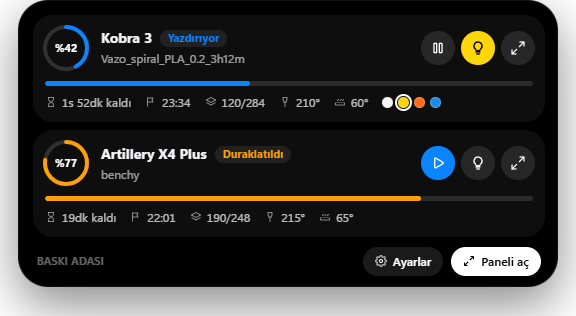
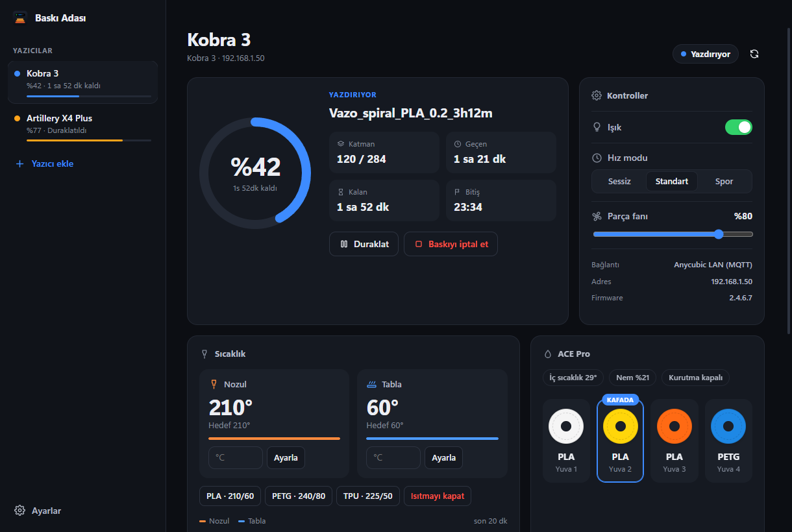

# Baskı Adası

3D yazıcıların için masaüstü durum uygulaması. Ekranın üstünde iPhone'daki "dinamik ada" gibi küçük bir kapsül durur. Baskının yüzdesini ve kalan süresini oradan görürsün. Üzerine gelince açılır; sıcaklıklar, katman, bitiş saati ve filament renkleri görünür. Tam panelden yazıcıyı kontrol edebilir, dosya yükleyebilirsin.

Her şey evindeki ağda olur. Bulut hesabı, üyelik ya da internet gerekmez; uygulama yazıcıyla doğrudan konuşur.

<p align="center"></p>
<p align="center"></p>



## İndir

Son sürüm: **[Releases sayfası](https://github.com/Sertacerten06/baski-adasi/releases/latest)**

| Sistem | Dosya |
|---|---|
| Windows (önerilen) | `BaskiAdasi-…-kurulum.exe` |
| Windows (kurulumsuz) | `BaskiAdasi-…-tasinabilir.exe` |
| Mac, Apple Silicon (M1/M2/M3/M4) | `BaskiAdasi-…-arm64.dmg` |
| Mac, Intel | `BaskiAdasi-…-x64.dmg` |

Paketler imzalı değil (imza sertifikası ücretli). İlk açılışta işletim sistemi uyarı verebilir:

- **Windows:** "Windows bilgisayarınızı korudu" derse **Ek bilgi** > **Yine de çalıştır**.
- **macOS:** Uygulamayı Uygulamalar klasörüne sürükle ve bir kez açmayı dene. "Açılamıyor" derse **Sistem Ayarları > Gizlilik ve Güvenlik**'e gir, en altta **Yine de Aç**'a bas. Ya da Terminal'de şunu çalıştır:
  ```
  xattr -cr "/Applications/Baski Adasi.app"
  ```

## Desteklenen yazıcılar

| Yazıcı | Nasıl bağlanır | Yapman gereken |
|---|---|---|
| **Anycubic Kobra 3 / Kobra 3 Max / Kobra S1** (Kobra 3 Combo'da test edildi) | LAN modu (yazıcıdaki MQTT) | Yazıcının ekranından **LAN modunu** aç. ACE Pro yuvaları da görünür. |
| **Artillery Sidewinder X4 / M1** ve diğer **Klipper** yazıcılar (Moonraker) | Moonraker (port 7125 ya da 80) | Yazıcıyı Wi-Fi'ye bağla. Henüz gerçek bir Artillery'de denenmedi; sorun görürsen Issues'a yaz. |
| Eski Marlin yazıcılar (Sidewinder X1/X2/X3, Genius vb.) | — | Bunlarda Wi-Fi yok. Yanına Klipper ya da OctoPrint kurulu bir Raspberry Pi gerekir. |

Anycubic'te LAN modu açıkken yazıcı Anycubic bulut uygulamasından çıkar; ikisi aynı anda çalışmıyor.

## Kullanım

- **Yazıcı ekleme:** İlk açılışta uygulama ağı tarar ve bulduğu yazıcıları kendisi ekler. Bulamazsa **Ayarlar > Yazıcılar**'dan IP adresini yaz, örneğin `192.168.1.50` ya da `192.168.1.50:7125`. Yazıcının IP'sini modemin arayüzünde ya da yazıcının ağ ayarlarında görebilirsin.
- **Ada:**
  - Üzerine gelince açılır. Duraklat/devam ve ışık düğmeleri burada.
  - Baskı bitince yeşil, hata olunca kırmızı parlar.
  - Tarayıcı sekmelerinin üstüne denk gelirse **Ayarlar > Ada konumu**'ndan sol ya da sağ üst köşeye al.
- **Panel:** Tepsi simgesine tıkla ya da adadaki **Paneli aç**'a bas. Panelde şunlar var:
  - baskı ilerlemesi, katman, kalan süre ve bitiş saati
  - sıcaklık grafiği ve ön ısıtma
  - fan ve hız modu
  - dosya listesi; dosyayı pencereye sürükleyip bırakarak yüklersin
  - Klipper yazıcılarda listeden baskı başlatma
- **Bildirimler:** Baskı bitince, duraklayınca ya da hata verince sistem bildirimi gelir. Windows'ta bildirimler sadece kurulumlu sürümde çıkar.
- **Arka planda çalışma:** Panel penceresini kapatınca uygulama tepside çalışmaya devam eder. Tamamen kapatmak için tepsi menüsünden **Çıkış**'ı seç. **Bilgisayar açılınca başlat** seçeneği de aynı menüde.

## Sorun çözme

- **Yazıcı bulunamıyor:**
  - Bilgisayar ile yazıcı aynı Wi-Fi'ye bağlı olmalı. Misafir ağı ya da "AP izolasyonu" cihazların birbirini görmesini engeller.
  - Anycubic'te LAN modunun açık olduğundan emin ol.
  - Olmazsa IP'yi elle gir.
- **Ağ taraması neden yaklaşık 1 dakika sürüyor?** Hızlı tarama bazı yazıcıların (Kobra 3 gibi) Wi-Fi'sini birkaç saniye tıkayabiliyor. Bu yüzden tarama bilerek yavaş. Otomatik tarama 30 dakikada bir çalışır, ulaşılamayan bir yazıcı varsa 15 dakikada bir. IP'si değişen yazıcıyı da bulur.
- **"Çevrimdışı" görünüyor:** Uygulama birkaç saniyede bir yeniden bağlanmayı dener. Yazıcı uyku modundaysa ya da Wi-Fi'si zayıfsa kısa kopmalar normal.

## Geliştirme

[Node.js](https://nodejs.org) 20 ya da üstü gerekir.

```
npm install
npm start
```

- `npm run icons`: simgeleri yeniden üretir.
- `npm run dist:win`: Windows paketlerini `dist/` klasörüne derler.
- `npm run dist:mac`: Mac paketlerini derler (sadece Mac'te çalışır).
- `BADASI_SNAP=<klasör> npm start`: ada ve panelin ekran görüntülerini alıp çıkar; arayüz geliştirirken işe yarar.

Yeni yazıcı desteği eklemek için `src/printers/base.js`'deki ortak durum yapısını kullanan bir sürücü yaz (örnek: `moonraker.js`), sonra onu `manager.js` ve `discovery.js`'ye ekle.

### Sürüm çıkarma

`package.json`'daki sürümü artır, ardından etiket gönder:

```
git tag v1.0.1
git push origin v1.0.1
```

GitHub Actions ([`.github/workflows/derle.yml`](.github/workflows/derle.yml)) Windows ve Mac paketlerini derleyip Releases sayfasına koyar.

## Teşekkürler

Anycubic LAN protokolü şu açık kaynak projelerden öğrenildi: [kobra-connect](https://github.com/rvanderp3/kobra-connect), [anycubic_ha_local](https://github.com/chrisfore/anycubic_ha_local). Klipper tarafı [Moonraker API](https://moonraker.readthedocs.io/)'sini kullanıyor.

Anycubic ve Artillery ile bir bağlantısı olmayan, bağımsız bir projedir.

## Lisans

[MIT](LICENSE)
